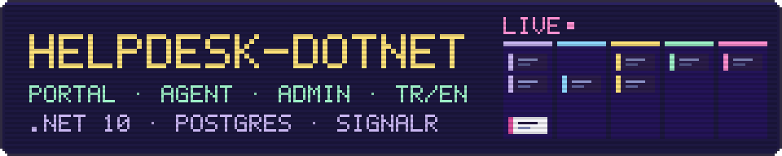
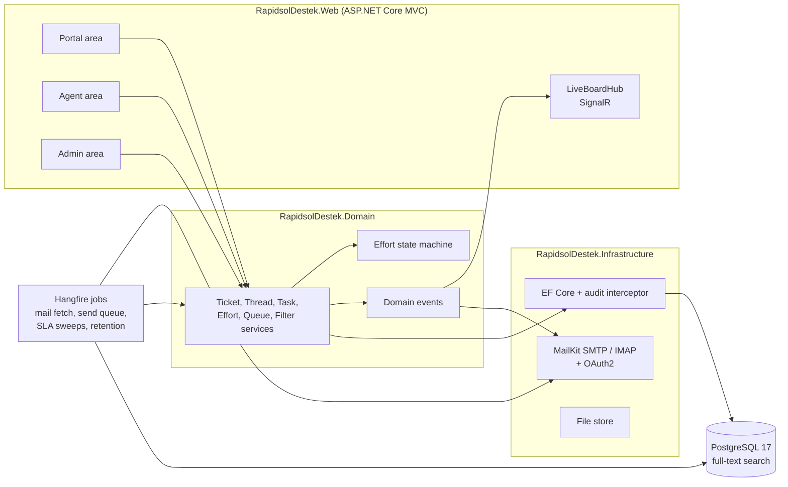
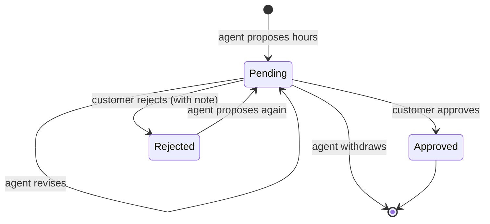

<p align="center">
  
</p>

<p align="center">
  <a href="https://github.com/bou-slh/BTicketing-System/actions/workflows/ci.yml"></a>
  
  
  
  
</p>

# helpdesk-dotnet

A full customer-support helpdesk built from scratch in **C# / ASP.NET Core**: a customer portal, an agent workspace with a real-time board, and an admin panel with visual builders. Every screen works in **Turkish and English**, in **light and dark** mode.

Internally the product is called **RapidsolDestek** (*destek* is Turkish for "support"), which is why the namespaces use that name.

> **Status:** stages S0–S8 of 9 are complete. All 72 pages are built and the email subsystem is live. S9 (security hardening and launch) is next. See the [roadmap](#how-it-was-built).

---

## What it does

Three apps in one codebase, each with its own login:

| Panel | Who uses it | What they can do |
|---|---|---|
| **Portal** (12 pages) | Customers | Open tickets, reply, track status, search the knowledge base, approve or reject proposed work hours |
| **Agent** (18 pages) | Support staff | Work queues, a live board, ticket and task threads, canned responses, users and organizations, KB editing |
| **Admin** (42 pages) | Administrators | Staff, roles and permissions, departments, SLAs and schedules, email accounts, templates, and builders for queues, forms, lists and filters |

### Highlights

- **Effort approval loop.** An agent proposes the hours a job will take, and the customer approves in one click or rejects with a note. Revisions, withdrawals, revision limits and "block work until approved" are all handled by a pure, exhaustively tested state machine. This flow has no equivalent in osTicket; it's this product's signature feature.
- **Live board.** A five-column kanban powered by SignalR. When an agent claims a ticket, it moves on every other agent's screen in under a second, and tickets close to breaching their SLA get their own "SLA at risk" column.
- **Email in both directions.** Incoming mail is fetched over IMAP and becomes tickets. Replies thread back onto the right ticket through a signed reply token, so customers never need to keep a ticket number in the subject. Loop, bounce and auto-reply protection are built in, plus OAuth2 sign-in for Microsoft 365 and Google Workspace mailboxes.
- **Admin builders that change real behavior.** A queue built in the admin panel appears in the agent's queue tree, and its preview tab shows matching tickets before you save. Forms built in the designer render on both ticket-open pages and validate input.
- **SLAs that respect business hours.** Schedules with working hours and public holidays drive the SLA clock. Background sweeps mark overdue tickets and send reminders.
- **Security by design.** Customers and staff are separate identities with separate cookies. Admins must use TOTP two-factor authentication. Lockout policies apply, and every data change writes an audit record automatically.
- **Fully bilingual.** No hardcoded text in any view: every string goes through resource files, with Turkish as the default and English one click away.

---

## Architecture



- **Domain** holds entities and services with no framework dependencies.
- **Infrastructure** holds EF Core, email transport and file storage.
- **Web** holds the three MVC areas, the SignalR hub and the localization resources.

Domain events connect the layers: a ticket change notifies the live board and the mail handlers without the ticket service knowing either exists.

### The effort approval loop



Admin settings shape the loop: turning it on or off, blocking work until approval, requiring a rejection note, a revision limit, and reminder emails for proposals still waiting.

---

## Tech stack

| Layer | Choice |
|---|---|
| Runtime | .NET 10, ASP.NET Core MVC with Razor areas |
| Data | EF Core, PostgreSQL 17, `tsvector` full-text search |
| Real time | SignalR |
| Background jobs | Hangfire (PostgreSQL storage) |
| Email | MailKit / MimeKit, OAuth2 for Microsoft 365 and Google Workspace |
| Auth | ASP.NET Core Identity, two principals, TOTP 2FA |
| Testing | xUnit, Testcontainers, Playwright, GreenMail |
| Delivery | Docker Compose, GitHub Actions |

---

## Run it locally

You need **Docker**. For development without Docker for the app itself, you also need the **.NET 10 SDK**.

**Everything in Docker:**

```bash
git clone https://github.com/bou-slh/BTicketing-System.git
cd BTicketing-System
docker compose up --build
```

Open <http://localhost:8080>. In the Development environment (the Compose default), the database is migrated and seeded with demo data on startup.

**For development** (hot reload):

```bash
docker compose up -d db
dotnet watch --project src/RapidsolDestek.Web
```

Open <http://localhost:5114>.

### Demo accounts

All seeded accounts use the password `rapidsol1dev`.

| Panel | URL | Sign in as |
|---|---|---|
| Portal | `/login` | `bourla.salehi@ulasim.com.tr` |
| Agent | `/agent/login` | `dkaya`, `saydin`, `kyilmaz`, `mcetin` or `adogan` |
| Admin | `/admin/login` | `uakin` + a TOTP code: add `Seed:AdminTotpKey` from `appsettings.Development.json` to any authenticator app |

Try the golden path: open a ticket in the portal, sign in as `saydin` and propose 6 hours of effort, approve it back in the portal, then resolve the ticket as the agent. Open `/agent/live` in two browsers to watch the board update.

---

## Tests

```bash
dotnet test --filter "Category!=E2E"   # unit + integration (Docker required, Testcontainers starts PostgreSQL)
```

**406 unit and integration tests** cover every service and admin page. **8 Playwright end-to-end tests** prove the stage gates in a real browser:

| Test | What it proves |
|---|---|
| `PortalGoldenPathTests` | A new customer registers, opens a ticket, replies, and approves or rejects effort |
| `GoldenPathTests` | Portal → agent proposes 6h → customer approves → agent resolves, both panels in sync |
| `LiveBoardTests` | Two agents on the live board: one claims a ticket, the other sees it move in under a second |
| `QueueBuilderTests` | An admin builds a queue in the UI, the live preview matches, and an agent finds exactly those tickets |
| `MailRoundTripTests` | Real SMTP and IMAP: customer email → ticket → auto-reply → agent reply → customer reply threads onto the same ticket |
| `SmokeTests` | Agent login reaches the dashboard and the portal renders in Turkish by default |

CI runs the unit and integration suite on every push and pull request, followed by the Playwright smoke job.

---

## How it was built

The project follows a **spec-first** approach. Before any code was written, **72 static HTML mockups** (portal 12, agent 18, admin 42) were frozen as the binding specification. A page counts as done only when every control on it works in Turkish and English, in light and dark mode. Rendering correctly is not enough.

The domain model uses [osTicket](https://osticket.com) as a **reference only**. A parity matrix maps every osTicket subsystem to its equivalent here, and no osTicket code is reused.

| Stage | Scope | Status |
|---|---|---|
| S0 | Spec freeze, mockup consistency pass | ✅ |
| S1 | Solution skeleton, Docker, CI, AI tooling | ✅ |
| S2 | Layouts, i18n, authentication, 2FA | ✅ |
| S3 | Domain model, audit trail, seed data | ✅ |
| S4 | Core services incl. effort state machine | ✅ |
| S5 | Customer portal (12 pages) | ✅ |
| S6 | Agent workspace and live board (18 pages) | ✅ |
| S7 | Admin panel and builders (42 pages) | ✅ |
| S8 | Email subsystem, inbound and outbound | ✅ |
| S9 | Security review, performance, launch | Next |

The full roadmap, parity checklists and exit gates are in [`mockups/ROADMAP.md`](mockups/ROADMAP.md).

### AI-assisted workflow

This repo was built with **Claude Code**, using tooling that is committed alongside the code so the workflow is reproducible:

- **Skills**: `/port-page` turns a mockup into a working page with an i18n audit and a visual diff; `/add-entity`, `/add-setting` and `/verify` (the build + tests + i18n + smoke gate run before every commit).
- **Specialized subagents**: page porter, schema reviewer, i18n auditor, visual differ and test writer, each with a narrow job.
- **Guardrail hooks**: C# edits are auto-formatted and build-checked, view edits trigger the i18n checker, and hand-editing migrations or pushing straight to `main` is blocked.
- **MCP servers**: Playwright for visual verification against the mockups, and PostgreSQL for inspecting the schema.

The AI did the typing; the spec, gates and tests decided what counted as done.

---

## Project structure

```
src/
  RapidsolDestek.Domain/          entities, services, state machines, domain events
  RapidsolDestek.Infrastructure/  EF Core, migrations, mail transport, file store, seeding
  RapidsolDestek.Web/             Areas/{Portal,Agent,Admin}, LiveBoardHub, resx localization
tests/
  RapidsolDestek.Tests/           xUnit unit + integration tests (Testcontainers)
  RapidsolDestek.E2E/             Playwright end-to-end gate tests
mockups/                          the 72-page binding spec, roadmap, conventions
tools/                            i18n converter and checker
.claude/                          agents, skills and hooks used to build the project
```

---

## What's next (S9)

- Authorization matrix tests for every role and endpoint, rate limiting, security headers, dependency scanning
- KVKK (Turkish data protection law) data inventory, retention jobs and consent texts
- Index audit, slow-query profiling and load tests on lists and search
- Backups, monitoring, health checks, and a rollback plan

---

## Author

**Bourla Salehi**, full-stack developer in Istanbul.
[Portfolio](https://bou-slh.github.io/Myportfolio/) · [LinkedIn](https://www.linkedin.com/in/bourla-salehi) · salehibourla@gmail.com
