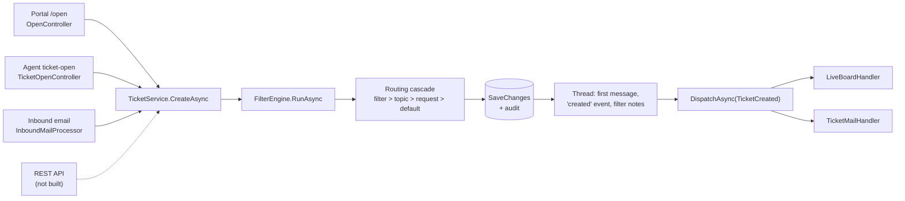
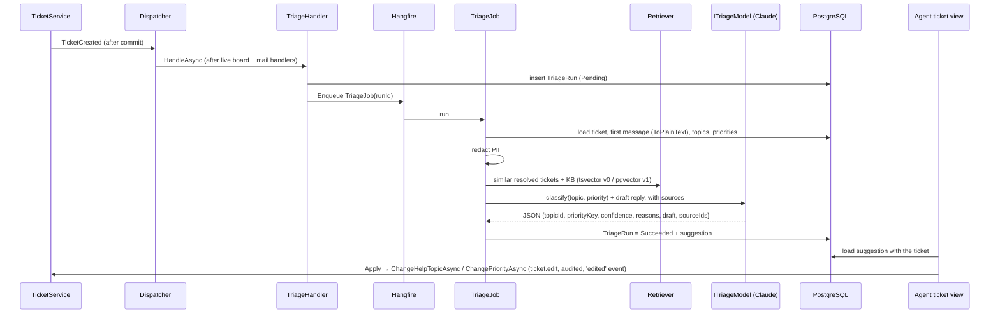

# AI Triage for helpdesk-dotnet: integration analysis

> **What this is.** A read-through of the helpdesk codebase (as of commit `0f46902`, S8 closed) to find where an AI triage feature fits and which existing conventions it must follow. Every claim cites a file. It ends with the decisions you need to make and a build order.
>
> **How it is wired in.** `CLAUDE.md` points here, so every Claude Code session knows this spec exists. Keep it up to date as slices land.

---

## 1. Bottom line

The helpdesk is already shaped for this feature. It has post-commit domain events, a persistent-outbox + Hangfire job pattern, feature modules toggled from the admin panel, typed settings, and a test harness that runs background jobs inline. AI triage can plug into all of these without changing the core ticket flow.

The original idea ("a separate service that talks to the helpdesk over its API") **doesn't fit the code as it stands**, for three reasons:

1. **There is no REST API yet.** API keys can be created in the admin panel, but nothing reads them.
2. **Agents can't change a ticket's priority or help topic after creation.** A suggestion would have nothing to apply to.
3. **The seed data is too thin to retrieve from or evaluate against.** It has 27 tickets, 5 thread messages, and 1 KB article with a real answer.

**Decision:** build triage **as a module inside helpdesk-dotnet**, following its own patterns, and ship the MCP server as an extra project in the same solution. The project is Bourla's own and the repo stays public (decided 21 Oct 2026). Section 6 lists the remaining decisions.

### Version 1 scope (decided 21 Oct 2026)

| In v1: agent side, human in the loop | Out of v1: later versions |
|---|---|
| Suggest help topic + priority, with reasons and confidence | Portal "suggested articles" while a customer types a new ticket |
| Show similar resolved tickets and related KB articles | Sending any AI-written reply automatically |
| Draft a reply the agent edits and sends | Auto-applying topic/priority without an agent click |
| Record every suggestion and what the agent did with it | Auto-answers for narrow, proven-safe ticket types via the existing autoresponse system |
| MCP server with read-only tools | MCP tools that change tickets |

**Rule for every v1 slice: the AI never changes a ticket or contacts a customer on its own.** An agent action is always the trigger. This settles decision D3 in §6.

---

## 2. How a ticket is born today

| Step | Where | What matters for triage |
|---|---|---|
| Entry points | `Portal/Controllers/OpenController.cs:115`, `Agent/Controllers/TicketOpenController.cs:244`, `Infrastructure/Services/InboundMailProcessor.cs:167` | All three converge on one method, so one hook covers every channel. |
| Create | `Infrastructure/Services/TicketService.cs:77` | `CreateAsync(TicketCreateRequest, ActorContext)`. |
| Filters | `TicketService.cs:101` | Rule-based routing already runs first (`FilterEngine`, keyword rules on subject/body/email). Triage complements this; it doesn't replace it. |
| Cascade | `TicketService.cs:124` (department), `:172` (priority) | *Filter action > help topic > request value > settings default.* **The help topic drives department, priority and SLA.** |
| Event | `TicketService.cs:253`, `Domain/Events/DomainEvents.cs:25` | `TicketCreated(TicketId, Number, UserId, DepartmentId, ActorStaffId, NotifyMode)` is raised after commit. This is the hook. |

**Why triage should not run inside `CreateAsync`:** that would put a slow, fallible network call to an AI provider in the middle of every ticket creation, including the email pipeline. The codebase deliberately keeps slow work off that path; see below.

---

## 3. Conventions the feature must follow

### 3.1 Events and background work

- **Dispatcher** (`Infrastructure/Events/DomainEventDispatcher.cs:21-58`): in-process, no MediatR. Handlers run **sequentially and awaited, in DI registration order**, and a failing handler is logged, never rethrown. The class comment explicitly warns that slow handlers delay later ones. S8 had to reorder handlers because mail composition slowed the live board (`mockups/ROADMAP.md`, S8 open item).
- **Rule for triage:** the handler must only persist a row and enqueue a job, never call the AI. It should be registered **after** `LiveBoardHandler` and the mail handlers in `Web/Program.cs:235-261`.
- **Outbox pattern to copy:** `Infrastructure/Services/MailQueue.cs:45-70` writes a row in its own scope, then calls `IBackgroundJobClient.Enqueue<OutboundMailJob>(...)`. A `TriageQueue` → `TriageJob` pair should mirror this exactly.
- **Recurring jobs** are registered in `Program.cs` after line 303 (SLA sweep, mail fetch, retention). Re-embedding the knowledge base would go here.

### 3.2 External HTTP calls

- Use a **typed `HttpClient` behind an interface**, the same way OAuth is done (`Program.cs:226-231`, `IMailOAuthTokenClient`). Tests swap the interface for a scripted fake, just as they swap `ISmtpMailTransport` (`tests/.../Support/AppFactory.cs:49`).
- So: `ITriageModel` (classify + draft) and `IEmbeddingModel`, with a Claude implementation in Infrastructure and fakes in tests. **CI must never call a real AI API.**

### 3.3 Settings and feature toggle

- Built-in feature modules live in `Admin/Controllers/PluginsController.cs:55-75` (`Catalog`), toggled via settings keys `features/<key>.installed` and `features/<key>.enabled`. **AI triage belongs here** as a new module (e.g. key `ai_triage`), so admins can switch it off in one click.
- Typed settings: `ISettingsService` with `Get<Section>Async` records (`SettingsService.cs:191-207`). Add a `TriageSettings` record via the repo's own **`/add-setting`** skill.
- Candidate settings: enabled, model name, minimum confidence to show a suggestion, sources to retrieve from (resolved tickets / KB / canned), PII redaction on/off.

### 3.4 Permissions, audit, thread history

- Permission keys: `Domain/Services/PermissionKeys.cs`. Applying a suggestion changes the ticket, so it should require **`ticket.edit`** (line 12). Viewing suggestions can follow ticket visibility.
- Every mutation writes an `AuditEvent` through the EF interceptor; high-volume technical rows opt out with `INotAudited` (e.g. `EmailOutbound`, `ThreadEvent`). Embedding rows should be `INotAudited`; **applying** a suggestion goes through `TicketService` and is audited normally.
- Ticket history uses `ThreadService.AddEventAsync(threadId, eventTypeName, ...)` (`ThreadService.cs:201`) with names seeded in `DomainSeeder.cs:54-61`. An applied suggestion should add an `edited` event (it already exists) with JSON data like `{"field":"priority","from":"normal","to":"high","source":"ai-triage"}`, so the AI's influence is always visible on the timeline.

### 3.5 UI: the mockups are the spec

- `CLAUDE.md`: *"mockups/ is the binding spec… do not edit without S0-style sign-off."* Every UI change starts as a mockup page, in **TR and EN, light and dark**.
- New UI needed:
  - `mockups/agent/ticket-view.html`: a triage panel (suggested topic, priority, confidence, similar tickets, "Apply" / "Insert draft" buttons). The page already uses `rd-surface` cards, `rd-banner` and `bo-def` rows, so reuse those.
  - `mockups/admin/plugins.html`: the new module row.
  - A settings section, either a new `admin/settings-triage.html` or a block in `settings-tickets.html`.
- Then port it with the repo's **`/port-page`** skill (port → i18n audit → visual diff).
- **CSS parity rule:** `wwwroot/css/{base,portal,admin}.css` must stay byte-identical to the mockups. Any new styles go in `wwwroot/css/app.css`.
- **i18n:** no literal strings in views. Use `IStringLocalizer` + resx, with keys mirroring the mockup's `data-i18n` keys.

### 3.6 Draft replies: reuse the canned-response path

- The agent composer already inserts server-expanded text: `GET /agent/ticket-view/canned` (`TicketViewController.cs:336`). A "draft reply" is the same interaction with a different source. It inserts into the composer, and **the agent edits and sends it, never the system**.

### 3.7 Text extraction

- Thread bodies are HTML (`ThreadEntry.Format = "html"`, `Domain/Entities/Threads.cs:60-63`). `IHtmlSanitizerService.ToPlainText` (`HtmlSanitizerService.cs:12`) already exists, so use it before building prompts or embeddings.

### 3.8 Tests

- Integration tests use Testcontainers PostgreSQL (`tests/.../Support/PostgresFixture.cs:19`, image `postgres:17-alpine`) and **run Hangfire jobs inline** through `InlineJobClient` (`AppFactory.cs:37, 162-167`). A triage test can therefore do create ticket → handler → job → suggestion row in one synchronous test, with the fake model.
- E2E tests are Playwright, tagged `Category=E2E` (CI runs them in a separate job).
- Before every commit, run the repo's **`/verify`** gate: build + tests + i18n check + smoke.

---

## 4. Gaps found

| # | Gap | Evidence | Impact | Fix |
|---|---|---|---|---|
| G1 | **No REST API.** API keys can be managed but nothing consumes them. | `Admin/Controllers/ApiKeysController.cs:22`: `TODO(S8): consumed by the REST dispatcher` | An external triage service has no way in. | Build in-process (recommended), or build the API first (a project of its own, and it really belongs to S9 security work). |
| G2 | **Priority and help topic can't be changed after creation.** `ITicketService` has `Transfer` (department), `Assign`, `Claim` and status changes only. Ticket view shows priority read-only. | `TicketService.cs:42-66`; `mockups/agent/ticket-view.html:201` | A "suggested priority/topic" has nothing to apply to. | Add `ChangePriorityAsync` and `ChangeHelpTopicAsync` to `TicketService` (permission `ticket.edit`, `edited` thread event, audit, a domain event, SLA recompute on topic change like `TransferAsync` does at `:371-383`). **Useful even without AI**; it's an osTicket-parity gap. |
| G3 | **Seed data too thin for RAG or evaluation.** | `DomainSeeder.cs`: 27 tickets (most are subject-only), 5 thread entries in total, 16 KB articles where all but one have a placeholder body (`:460-483`), 7 canned responses | Retrieval would find nothing; there's nothing to measure accuracy on. | A synthetic dataset (§5.4). Keep it **out of the canon seed**: load it with a separate dev/eval command so §2 canon stays intact. |
| G4 | **No pgvector.** | `docker-compose.yml:3` (`postgres:17`), `PostgresFixture.cs:19` and `E2E/MailRoundTripTests.cs:69` (`postgres:17-alpine`) | Vector search impossible as configured. | Switch all three to `pgvector/pgvector:pg17`, add `CREATE EXTENSION vector` via migration (`dotnet ef`, never hand-edited). |
| G5 | **Topic-to-department labels disagree in the seed.** Topic *Vardiya* routes to *Danışmanlık* (`DomainSeeder.cs:382`), but seeded Vardiya tickets sit in *Destek* (`:783`, `:797`). | — | Department is a noisy label to predict. | **Predict the help topic (+ priority), not the department.** The existing cascade derives department and SLA from the topic, so the AI decides one thing and the system's own rules do the rest. |
| G6 | **Security hardening not done yet** (S9: rate limiting, authz matrix, dependency scan). | `mockups/ROADMAP.md` S9; no `AddRateLimiter` in `Program.cs` | Adding paid outbound AI calls before limits exist risks runaway cost. | A per-day job cap in `TriageSettings` and Hangfire retry limits from day one. |
| G7 | **KVKK by design.** The domain is payroll: salaries, SGK, severance, leave balances. | Seed subjects, e.g. `DomainSeeder.cs:773, 784` | Development and the portfolio use **invented data only**, so nothing blocks the build. But any company deploying this would be sending personal data to an external AI provider, which is a cross-border transfer under KVKK. | Build it in from v1: a redaction step (TC kimlik no, IBAN, phone, e-mail) before any prompt, an admin setting for it, and a short "Data protection" section in the README. A selling point, not a blocker. |
| G8 | **Embeddings provider.** The Claude API generates text but has no embeddings endpoint; Anthropic's docs point to third-party providers such as Voyage AI. | — | A second vendor, or a local model. | Decide in §6. Start without embeddings: v0 retrieval uses the **existing `tsvector` full-text search** (G9). |
| G9 | *(Not a gap, an asset.)* Full-text search exists on `tickets(number, subject)` and `thread_entries(title, body)`, `simple` config, GIN-indexed. | `Migrations/20260813142902_S4_Search.cs`; `DomainModelConfiguration.cs:54, 77` | A free baseline retriever. | Use it as retrieval v0, then measure pgvector against it. That comparison is a strong README result. |

---

## 5. Recommended design

### 5.1 Where it lives

| | **A. Module inside helpdesk-dotnet** (recommended) | B. Separate repo / service |
|---|---|---|
| Integration | Domain events, services, permissions, audit: all direct | Needs the REST API (G1) first |
| Consistency | Same conventions, skills (`/add-entity`, `/add-setting`, `/port-page`, `/verify`), test harness | Re-implements ticket concepts outside the domain |
| Portfolio story | "My helpdesk has AI triage" in one flagship | Two repos, the second depends on a private-ish first |
| Public visibility | Tied to the helpdesk repo's status | Can stay public independently |

The last row was the one real argument for B. Since the project is Bourla's own and stays public, it no longer applies: **A is decided.**

### 5.2 Flow

### 5.3 New pieces

| Layer | Piece | Notes |
|---|---|---|
| Domain | `TriageRun` entity: ticket id, status (Pending/Succeeded/Failed/Skipped), model, suggested topic id, suggested priority key, confidence, reasons, draft text, source ids (JSON), token usage, timings, `AppliedAt`/`AppliedByStaffId`, `Dismissed` | Use `/add-entity`. Storing what was suggested **and** what the agent did is your evaluation data from real use. |
| Domain | `DocumentEmbedding` (v1): document type (ticket / KB / canned), id, content hash, model, vector | `INotAudited`; re-embed only when the hash changes. |
| Domain | `TicketPriorityChanged`, `TicketHelpTopicChanged` events | Raised by the new G2 methods; the live board can subscribe too. |
| Infrastructure | `TicketService.ChangePriorityAsync`, `ChangeHelpTopicAsync` | G2. Ship and test these first. |
| Infrastructure | `TriageQueue`, `TriageJob`, `ITriageRetriever` (FullText / Vector), `ITriageModel`, `IPiiRedactor`, `ClaudeTriageModel` (typed `HttpClient`) | Mirrors `MailQueue`/`OutboundMailJob`. |
| Web | `TriageHandler : IDomainEventHandler<TicketCreated>` | Registered last. Skips if the module is disabled, the ticket was opened by an agent who already chose a topic, or a filter already set the topic. |
| Web | Ticket-view panel + `POST /agent/ticket-view/triage/apply`, `/dismiss`, `GET /draft` | Mockup first (§3.5). |
| Web | `ai_triage` row in `PluginsController.Catalog` + settings page | `/add-setting`. |
| Project | `RapidsolDestek.Mcp` (new) | stdio MCP server in the same solution, calling the services with a configured staff `ActorContext` so permissions still apply. Start read-only: `search_tickets`, `get_ticket`, `similar_tickets`, `draft_reply`. |
| Tool | `tools/triage-eval` (new) | Runs the eval set against the real model and writes a results table. **Not part of CI.** |

### 5.4 Dataset

- **Eval set: 50 labeled tickets.** Each has a subject, a body, the correct help topic and priority, and the language. Mostly Turkish, about 20% English.
- **Retrieval corpus: about 150 resolved tickets with agent replies, plus the 16 KB articles given real bodies.**
- Everything follows §2 canon names: topics *Bordro, Yol Ücreti, İzin, Vardiya, Danışmanlık* (note: *Vardiya* is seeded inactive and *Danışmanlık* non-public, `DomainSeeder.cs:382-383`; the classifier should only offer topics that are active at prediction time); priorities *low/normal/high/emergency*; companies *Ulaşım A.Ş., Tosyalı Holding, Konecta, RapidSol*. It is **all invented, never real tickets.**
- Include deliberately hard cases: vague subjects, two topics in one message, angry tone with low real urgency, an English ticket about a Turkish payroll concept.
- Stored as JSON under `tests/RapidsolDestek.Tests/TriageData/` and loaded by a dev/eval command, not by `DomainSeeder` (G3).

### 5.5 How it's measured

| Metric | Meaning |
|---|---|
| Topic accuracy | Correct help topic, out of 50 |
| Priority accuracy and "within one level" | Exact, and off by at most one step |
| Calibration | Are high-confidence suggestions actually right more often? This sets the minimum-confidence setting. |
| Retrieval hit rate | Is a truly related ticket in the top 5? Full-text v0 vs pgvector v1. |
| Cost and latency | Tokens and seconds per ticket |
| Real-use acceptance | Share of suggestions agents applied, from `TriageRun.AppliedAt` |

---

## 6. Decisions to make before coding

| # | Decision | Options | My recommendation |
|---|---|---|---|
| D1 | Can this repo stay public, and can it send ticket text to an AI provider? | — | ✅ **Decided:** the project is Bourla's own and stays public. All data is invented, so sending it to an AI provider is fine; real-deployment KVKK is handled by design (G7). |
| D2 | Where the feature lives | A in-repo · B separate repo | ✅ **Decided: A**, a module inside helpdesk-dotnet. |
| D3 | Suggest-only or auto-apply | Suggest-only · auto-apply above a confidence | ✅ **Decided: suggest-only for v1** (see §1 scope). Auto-apply later behind a setting, once calibration data exists. |
| D4 | Embeddings | Voyage AI (Anthropic-recommended partner) · a local multilingual model · none for now | **None for v0** (full-text). For v1, pick the option that gives the better eval result; a local model is the stronger KVKK story, an API is simpler to run. |
| D5 | Models | Faster/cheaper model for classification, stronger one for drafts | Configurable in `TriageSettings`; pick defaults once the eval runs. |
| D6 | Mockup sign-off | Who approves the new ticket-view panel and settings page | You, recorded in ROADMAP, matching how S0 worked. |

---

## 7. Build order

Same rhythm as the helpdesk stages: dependency order, each slice ends green on `/verify`.

| Slice | Scope | Gate |
|---|---|---|
| **T0** | D4–D6 decided; mockups for the ticket-view panel, plugin row and settings, TR/EN, light/dark | Mockups reviewed; ROADMAP gets a "T" section |
| **T1** | G2: `ChangePriorityAsync`, `ChangeHelpTopicAsync`, events, ticket-view controls | Tests: permission denied without `ticket.edit`, `edited` event written, SLA recomputed on topic change |
| **T2** | `TriageRun`, handler, queue, job, **fake** model, panel showing a suggestion, Apply/Dismiss | Integration test: create → suggestion row → apply changes the ticket. E2E: agent applies a suggestion. |
| **T3** | Dataset (§5.4) + loader; full-text retriever; PII redactor | Unit tests: redactor catches TC no / IBAN / phone / e-mail |
| **T4** | `ClaudeTriageModel` + `tools/triage-eval`; first results table | Results committed to `docs/ai-triage/RESULTS.md` |
| **T5** | Draft reply → composer insert, with cited sources | E2E: draft appears in the composer, nothing is sent |
| **T6** | pgvector images + `DocumentEmbedding` + vector retriever; re-run eval | Full-text vs vector comparison in RESULTS.md |
| **T7** | `RapidsolDestek.Mcp`, read-only tools | Demo: Claude Desktop answers "which Bordro tickets are about to breach SLA?" against the dev database |

T1 is worth doing even if the AI part waits: it fills a real gap in the product.

---

## Appendix: file index

| Topic | File |
|---|---|
| Ticket entity, priorities, statuses | `src/RapidsolDestek.Domain/Entities/Tickets.cs` |
| Threads, entries, events | `src/RapidsolDestek.Domain/Entities/Threads.cs` |
| Help topics, SLA, filters, queues | `src/RapidsolDestek.Domain/Entities/Routing.cs` |
| KB and canned responses | `src/RapidsolDestek.Domain/Entities/Kb.cs` |
| Domain events | `src/RapidsolDestek.Domain/Events/DomainEvents.cs` |
| Permission keys | `src/RapidsolDestek.Domain/Services/PermissionKeys.cs` |
| Create + routing cascade | `src/RapidsolDestek.Infrastructure/Services/TicketService.cs` |
| Rule-based routing | `src/RapidsolDestek.Infrastructure/Services/FilterEngine.cs` |
| Event dispatcher | `src/RapidsolDestek.Infrastructure/Events/DomainEventDispatcher.cs` |
| Outbox + job pattern | `src/RapidsolDestek.Infrastructure/Services/MailQueue.cs`, `OutboundMailJob.cs` |
| Settings | `src/RapidsolDestek.Infrastructure/Services/SettingsService.cs` |
| HTML → text | `src/RapidsolDestek.Infrastructure/Services/HtmlSanitizerService.cs` |
| Seed canon | `src/RapidsolDestek.Infrastructure/Seed/DomainSeeder.cs`, `IdentitySeeder.cs` |
| Full-text search | `src/RapidsolDestek.Infrastructure/Migrations/20260813142902_S4_Search.cs` |
| DI, handlers, Hangfire | `src/RapidsolDestek.Web/Program.cs` |
| Agent ticket view | `src/RapidsolDestek.Web/Areas/Agent/Controllers/TicketViewController.cs`, `mockups/agent/ticket-view.html` |
| Feature modules | `src/RapidsolDestek.Web/Areas/Admin/Controllers/PluginsController.cs` |
| API keys (unused) | `src/RapidsolDestek.Web/Areas/Admin/Controllers/ApiKeysController.cs` |
| Test harness | `tests/RapidsolDestek.Tests/Support/AppFactory.cs`, `PostgresFixture.cs` |
| Spec, canon, stages | `mockups/ROADMAP.md`, `mockups/CONVENTIONS.md`, `CLAUDE.md` |
